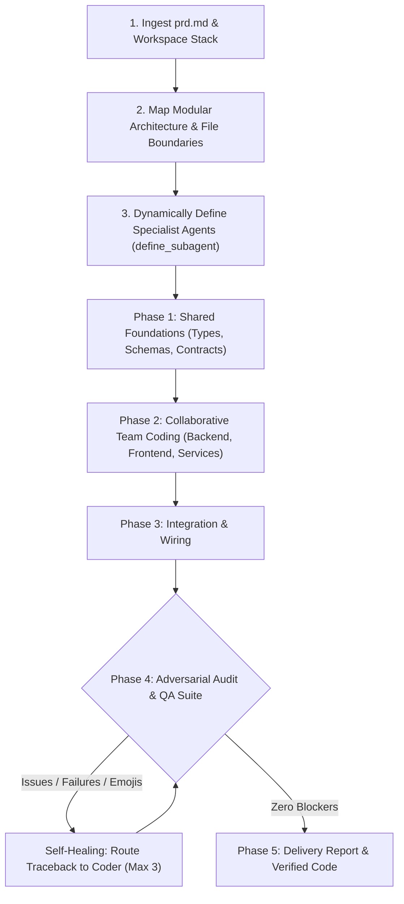

# `/agents`

> **Claude Code-style multi-agent coding orchestra for Gemini in Google Antigravity.**  
> Ingests a `prd.md`, dynamically spins up specialized engineer agents, partitions work streams, writes code collaboratively, and verifies everything with an automated self-healing test loop.

[](https://github.com/berlin-566/-agents)
[](https://deepmind.google/technologies/gemini/)
[](LICENSE)

---

## Quick Install (One-Liner)

Install `/agents` directly into your Antigravity configuration with a single command:

```bash
curl -fsSL https://raw.githubusercontent.com/berlin-566/-agents/main/install.sh | bash
```

*To update anytime, simply re-run the command above.*

---

## Mental Model & Architecture

When you build complex features, a single model doing everything can lose context, overlook edge cases, or introduce subtle regressions. In Claude Code, specialized agents coordinate to architect, code, and review simultaneously.

**`/agents` brings this exact collaborative team architecture to Gemini models in Antigravity:**



---

## Key Features

- **Dynamic Specialist Roster**: The lead Gemini coordinator analyzes your `prd.md` and dynamically defines tailored agents using `define_subagent` (e.g. `db-architect`, `backend-engineer`, `frontend-engineer`, `qa-auditor`).
- **Strict Zero-Emoji Policy**: Agents are strictly instructed never to insert or generate emojis in source code, docstrings, comments, test suites, commit messages, or chat updates. Reviewers automatically flag any emoji as a blocker.
- **Smart Model Tiering**:
  - **Gemini Pro**: Handles system architecture, contract definitions, and adversarial diff audits where high-order reasoning matters most.
  - **Gemini Flash / Inherit**: Powers high-speed code generation, surgical edits, and rapid test execution loops.
- **Strict File Ownership**: Agents work with partitioned boundaries (e.g., Backend owns `src/api/**`, Frontend owns `src/ui/**`), preventing conflicting edits and diff collisions.
- **Automated Self-Healing Loop**: If tests fail or the reviewer flags blockers, tracebacks and audit logs are immediately fed back to the responsible agent for automatic repair (up to 3 iterations).
- **In-Tree Workspace (`inherit`)**: All agents operate directly in your workspace with full access to project dependencies, environment variables, and git state.

---

## Usage

### 1. Build a Complete PRD
Create a `prd.md` (or `PRD.md`) file describing your feature or system, then run:

```bash
/agents build prd.md
```

*(If `prd.md` is already in the workspace root, just type `/agents`!)*

### 2. On-Demand Subcommands
You can also invoke individual phases of the team at any time:

| Command | Action |
| :--- | :--- |
| `/agents build prd.md` | Full end-to-end multi-agent team build from PRD |
| `/agents plan <feature>` | Dispatches Architect to generate technical spec & contracts |
| `/agents review` | Dispatches Adversarial Reviewer on current uncommitted `git diff` |
| `/agents test` | Dispatches QA Engineer to write tests and run project test runner |
| `/agents decompose <prd>` | Outputs modular task breakdown and agent assignments without coding |

---

## Repository Structure

```text
-agents/
|-- SKILL.md                          # Antigravity skill manifest & orchestration rules
|-- install.sh                        # One-liner remote/local installer
|-- uninstall.sh                      # Clean removal script
|-- references/
|   |-- agent_prompts.md              # Specialist system prompts & self-healing templates
|   `-- team_orchestration.md         # PRD decomposition & file isolation guidelines
|-- README.md                         # Documentation & quickstart
`-- LICENSE                           # MIT License
```

---

## Manual Installation

If you prefer not to use `curl`, clone the repository directly into your Antigravity skills directory:

```bash
mkdir -p ~/.gemini/config/skills
git clone https://github.com/berlin-566/-agents.git ~/.gemini/config/skills/agents
```

---

## Contributing

Contributions, feedback, and custom agent templates are welcome.
Feel free to open an issue or submit a pull request.

---

## License

Released under the [MIT License](LICENSE).
