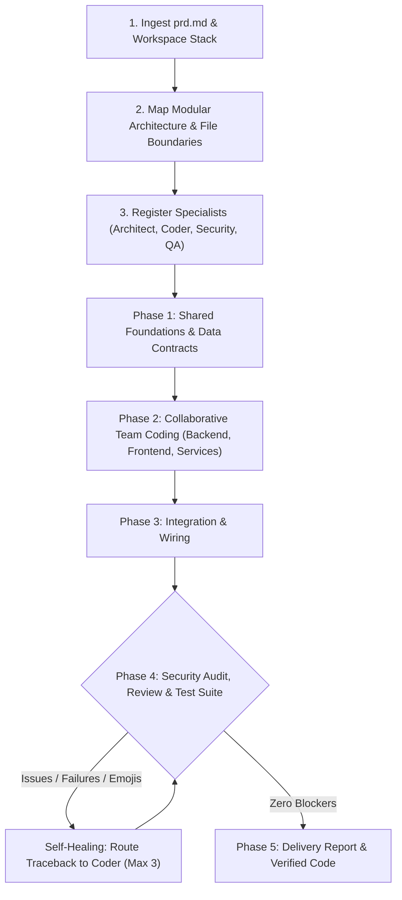

# `/agents`

> **Claude Code-style multi-agent specialist engineering team for Gemini in Google Antigravity.**  
> Ingests a `prd.md`, dynamically spins up specialized engineer agents, partitions work streams, writes code collaboratively, and verifies everything with an automated self-healing test loop.

[](https://github.com/berlin-566/-agents)
[](https://deepmind.google/technologies/gemini/)
[](LICENSE)

---

## Quick Install (One-Liner)

Install the complete multi-agent suite with a single command:

```bash
curl -fsSL https://raw.githubusercontent.com/berlin-566/-agents/main/install.sh | bash
```

### What the Auto-Installer Handles
- **Multi-Agent Plugin & Rules Registration**: Automatically installs both the `/agents` skill and the Antigravity plugin rules (`plugins/agents/rules/AGENTS.md`) so that Antigravity automatically knows and registers all specialist agents out-of-the-box in every session.
- **Directory Detection & Creation**: Automatically checks if `~/.gemini/config/skills/agents` and `~/.gemini/config/plugins/agents` exist, creating missing directories automatically.
- **Smart Upgrades**: Cleanly updates existing installations to the latest release.
- **Integrity Validation**: Verifies file sizes and integrity after downloading.
- **Zero Configuration**: Ready to use immediately across all your Antigravity workspaces.

### Optional: Local Workspace Install
To install only into the current project repository (`.agents/`):

```bash
curl -fsSL https://raw.githubusercontent.com/berlin-566/-agents/main/install.sh | bash -s -- --local
```

---

## The Specialist Agent Roster

By default, Antigravity provides only basic subagents. This package expands your team with seven dedicated specialist agents tailored to Gemini model tiers:

| Agent | Role | Model | Focus Area |
| :--- | :--- | :--- | :--- |
| **`gemini-security-researcher`** | Security Auditor | `pro` | OWASP Top 10, auth/session bypass, injection, secret leaks, CVE analysis |
| **`gemini-code-expert`** | Algorithmic Specialist | `pro` | Deep math, state machines, difficult algorithms, architectural refactoring |
| **`gemini-perf-expert`** | Performance Engineer | `pro` | CPU/memory profiling, leak detection, latency bottlenecks, concurrency |
| **`gemini-architect`** | Systems Architect | `pro` | PRD decomposition, interface definitions, API contracts, modular bounds |
| **`gemini-coder`** | Senior Engineer | `flash` | Surgical code implementation, minimal diff footprint, language idioms |
| **`gemini-reviewer`** | Adversarial Auditor | `pro` | Adversarial diff audit, regression catch, zero-emoji compliance |
| **`gemini-tester`** | QA Engineer | `flash` | Automated test suite execution (`npm test`, `pytest`, `cargo test`), test generation |

---

## Mental Model & Team Workflow



---

## Key Features

- **Expanded Specialist Roster**: Out-of-the-box support for security researchers, domain experts, performance engineers, and automated QA.
- **Strict Zero-Emoji Policy**: Agents are strictly instructed never to insert or generate emojis in source code, docstrings, comments, test suites, commit messages, or chat updates. Reviewers automatically flag any emoji as a blocker.
- **Smart Model Tiering**: High-reasoning `pro` models handle architecture, security audits, and adversarial reviews; high-speed `flash`/`inherit` models handle code editing and test loops.
- **Strict File Ownership**: Agents work with partitioned boundaries, preventing conflicting edits and diff collisions.
- **Automated Self-Healing Loop**: If tests fail or the reviewer/security auditor flags blockers, tracebacks and audit logs are immediately fed back to the responsible agent for automatic repair (up to 3 iterations).
- **In-Tree Workspace (`inherit`)**: All agents operate directly in your workspace with full access to project dependencies, environment variables, and git state.

---

## Usage & Subcommands

### 1. Build a Complete PRD
Create a `prd.md` (or `PRD.md`) file describing your feature or system, then run:

```bash
/agents build prd.md
```

*(If `prd.md` is already in the workspace root, just type `/agents`!)*

### 2. Specialist Subcommands
You can call any specialist individually on demand:

| Command | Action |
| :--- | :--- |
| `/agents build prd.md` | Full multi-agent team build from PRD |
| `/agents security` | Dispatches Security Researcher to audit vulnerabilities and CVEs |
| `/agents expert <topic>` | Dispatches Code Expert for deep algorithmic or architectural problems |
| `/agents perf` | Dispatches Performance Engineer to profile memory and CPU bottlenecks |
| `/agents review` | Dispatches Adversarial Reviewer on current uncommitted `git diff` |
| `/agents test` | Dispatches QA Engineer to write tests and run project test runner |
| `/agents plan <task>` | Dispatches Architect to generate technical spec & contracts |

---

## Repository Structure

```text
-agents/
|-- SKILL.md                          # Antigravity skill manifest & orchestration rules
|-- plugin.json                       # Antigravity plugin manifest
|-- rules/
|   `-- AGENTS.md                     # Always-active rule registering the expanded specialist roster
|-- install.sh                        # Auto-installer for skills and plugin rules
|-- uninstall.sh                      # Clean removal script
|-- references/
|   |-- agent_prompts.md              # System prompts for all 7 specialist agents
|   `-- team_orchestration.md         # PRD decomposition & file isolation guidelines
|-- README.md                         # Documentation & quickstart
`-- LICENSE                           # MIT License
```

---

## Manual Installation

If you prefer not to use `curl`, clone the repository and run the local installer:

```bash
git clone https://github.com/berlin-566/-agents.git /tmp/-agents
/tmp/-agents/install.sh
rm -rf /tmp/-agents
```

---

## License

Released under the [MIT License](LICENSE).
