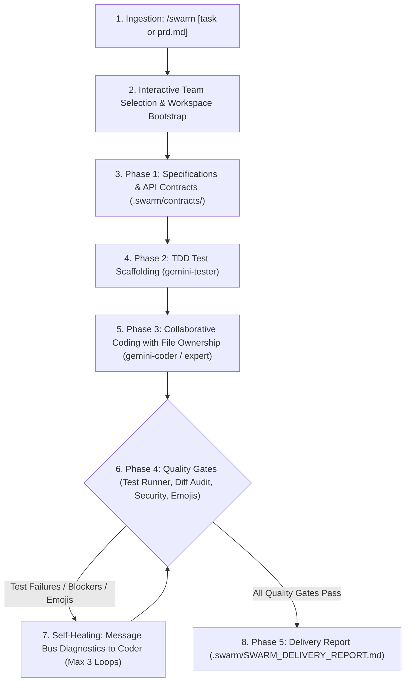

# `/swarm`

> **Multi-agent autonomous engineering team orchestra for Gemini in Google Antigravity.**  
> Transforms `/swarm` into a full-fledged collaborative engineering organization: agents communicate with each other over an inter-agent message bus, track tasks on an active state machine, enforce contract-driven architectures, author tests before code, perform adversarial reviews, run automated QA, and execute self-healing repair loops until full project delivery.

[](https://github.com/berlin-566/-swarm)
[](https://deepmind.google/technologies/gemini/)
[](scripts/emoji_linter.py)
[](LICENSE)

---

## Quick Install (One-Liner)

Install the complete swarm suite with a single command:

```bash
curl -fsSL https://raw.githubusercontent.com/berlin-566/-swarm/main/install.sh | bash
```

### What the Auto-Installer Handles
- **Multi-Agent Plugin & Rules Registration**: Automatically installs both the `/swarm` skill and the Antigravity plugin rules (`plugins/swarm/rules/SWARM.md`) so that Antigravity automatically knows and registers all specialist agents out-of-the-box in every session.
- **Engineered Team Tooling**: Automatically deploys the inter-agent message bus (`scripts/swarm_bus.py`), automated test runner (`scripts/test_runner.py`), zero-emoji linter (`scripts/emoji_linter.py`), and project orchestrator (`scripts/orchestrator.py`).
- **Directory Detection & Creation**: Automatically checks if `~/.gemini/config/skills/swarm` and `~/.gemini/config/plugins/swarm` exist, creating missing directories automatically.
- **Legacy Cleanup**: Automatically cleans up legacy `agents` plugin and skill folders to avoid any clashes.
- **Smart Upgrades**: Cleanly updates existing installations to the latest release.
- **Integrity Validation**: Verifies file sizes and integrity after downloading.
- **Zero Configuration**: Ready to use immediately across all your Antigravity workspaces.

### Optional: Local Workspace Install
To install only into the current project repository (`.swarm/`):

```bash
curl -fsSL https://raw.githubusercontent.com/berlin-566/-swarm/main/install.sh | bash -s -- --local
```

---

## The Specialist Agent Roster

Antigravity equips your workspace with seven dedicated specialist agents tailored to Gemini model tiers:

| Agent | Role | Model | Focus Area |
| :--- | :--- | :--- | :--- |
| **`gemini-architect`** | Principal Systems Architect | `pro` | Task/PRD decomposition, API contracts, modular boundaries, RFCs |
| **`gemini-coder`** | Senior Polyglot Engineer | `flash` | Surgical implementation, minimal diff footprint, language idioms |
| **`gemini-reviewer`** | Adversarial Auditor | `pro` | Adversarial diff audit, regression catch, zero-emoji compliance |
| **`gemini-tester`** | QA Engineer | `flash` | Automated test suite execution (`pytest`, `npm test`, `cargo test`), test generation |
| **`gemini-security-researcher`** | Security Auditor | `pro` | OWASP Top 10, auth/session bypass, injection, secret leaks, CVE analysis |
| **`gemini-code-expert`** | Algorithmic Specialist | `pro` | Deep math, state machines, difficult algorithms, architectural refactoring |
| **`gemini-perf-expert`** | Performance Engineer | `pro` | CPU/memory profiling, leak detection, latency bottlenecks, concurrency |

---

## How the Swarm Works as a Real Engineering Team

Unlike static prompts or isolated single-shot skills, `/swarm` functions as an end-to-end collaborative engineering unit:



### 1. Inter-Agent Communication Bus (`scripts/swarm_bus.py`)
Agents talk to each other directly! The bus coordinates messages, handoffs, and blockers in `.swarm/messages/` and `bus.jsonl`:
- **Lead Architect** publishes contracts and notifies the team:
  ```bash
  python3 scripts/swarm_bus.py msg broadcast --from gemini-architect --subject "RFC Ready" --body "Contracts in .swarm/contracts/."
  ```
- **QA Tester** dispatches test failures directly to Coder:
  ```bash
  python3 scripts/swarm_bus.py msg send --from gemini-tester --to gemini-coder --subject "Test Failure" --body "Assertion failed in auth.py:42" --type blocker
  ```
- **Reviewer & Security** send blockers or approval receipts to the Coordinator.

### 2. Task State Machine & Board
Every feature or bug is tracked through clear states: `PENDING` -> `IN_PROGRESS` -> `REVIEW` -> `PASSED` -> `DONE`.
```bash
python3 scripts/swarm_bus.py task list
```

### 3. Automated QA & Multi-Framework Test Runner (`scripts/test_runner.py`)
Auto-detects `pytest`, `unittest`, `npm test`, `cargo test`, `go test`, or executes custom test scripts, and automatically routes diagnostic tracebacks back to `gemini-coder` on failure.

### 4. Zero-Emoji Enforcement (`scripts/emoji_linter.py`)
Enforces a strict zero-emoji policy across all source code, comments, docstrings, commits, and reports.

---

## Workspace Directory Layout (`.swarm/`)

During active engineering, `/swarm` maintains a transparent, traceable project board:

```text
.swarm/
├── team.json                # Registered agent roster with models and status
├── tasks.json               # Task state machine and dependency board
├── bus.jsonl                # Append-only global inter-agent communication audit log
├── messages/                # Inboxes for each specialist agent
│   ├── gemini-architect/
│   ├── gemini-coder/
│   ├── gemini-reviewer/
│   └── gemini-tester/
├── contracts/               # Shared API specs, data schemas, and type interfaces
├── reports/                 # QA test outputs, security vulnerability scans, performance profiles
└── SWARM_DELIVERY_REPORT.md # Final verified delivery report
```

---

## Usage & Subcommands

### 1. Interactive Swarm
Run `/swarm` or provide a task directly:

```bash
/swarm
/swarm build user authentication service with JWT and refresh tokens
/swarm build prd.md
```

Antigravity prompts you to select the agents you want on your swarm team, boots the project workspace, registers them dynamically, and begins collaborative engineering.

### 2. Specialist Direct Subcommands

| Command | Action |
| :--- | :--- |
| `/swarm build prd.md` | Full multi-agent swarm build from PRD |
| `/swarm security` | Dispatches Security Researcher to audit vulnerabilities and CVEs |
| `/swarm expert <topic>` | Dispatches Code Expert for deep algorithmic or architectural problems |
| `/swarm perf` | Dispatches Performance Engineer to profile memory and CPU bottlenecks |
| `/swarm review` | Dispatches Adversarial Reviewer on current uncommitted `git diff` |
| `/swarm test` | Dispatches QA Engineer to write tests and run project test runner |
| `/swarm plan <task>` | Dispatches Architect to generate technical spec & contracts |

---

## Repository Structure

```text
-swarm/
|-- SKILL.md                          # Antigravity skill manifest & orchestration rules
|-- plugin.json                       # Antigravity plugin manifest
|-- rules/
|   `-- SWARM.md                      # Always-active rule registering the specialist roster
|-- scripts/
|   |-- swarm_bus.py                  # Inter-agent message bus & task board CLI
|   |-- test_runner.py                # Multi-framework QA test runner with auto-routing
|   |-- emoji_linter.py               # Zero-emoji policy enforcer
|   `-- orchestrator.py               # Master workflow pipeline & delivery generator
|-- tests/
|   |-- test_swarm_bus.py             # Test suite for swarm message bus
|   |-- test_emoji_linter.py          # Test suite for zero-emoji linter
|   `-- test_orchestrator.py          # Test suite for orchestrator
|-- references/
|   |-- agent_prompts.md              # System prompts & message bus commands for all agents
|   `-- team_orchestration.md         # PRD decomposition, lifecycle & file isolation guidelines
|-- install.sh                        # Auto-installer for skills, scripts, and plugin rules
|-- uninstall.sh                      # Clean removal script
|-- README.md                         # Documentation & quickstart
`-- LICENSE                           # MIT License
```

---

## Manual Installation

If you prefer not to use `curl`, clone the repository and run the local installer:

```bash
git clone https://github.com/berlin-566/-swarm.git /tmp/-swarm
/tmp/-swarm/install.sh
rm -rf /tmp/-swarm
```

---

## License

Released under the [MIT License](LICENSE).
