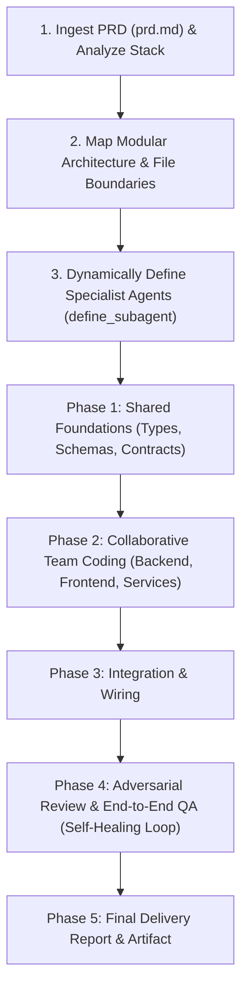

# `/agents` - PRD-Driven Multi-Agent Collaborative Coding Team

This skill transforms Antigravity into an autonomous software engineering team powered by Gemini models. Given a product requirements document (`prd.md`) or coding task, the coordinator dynamically designs the optimal agent team, registers each specialist via `define_subagent`, partitions the codebase into non-overlapping work streams, coordinates collaborative coding, and verifies the integrated build.

---

## 1. How It Works: The Team Lifecycle

When the user runs `/agents` (or `/agents build prd.md`), the coordinator executes the following workflow:

---

## 2. Invocation Modes

- **Full PRD Build**:
  - `/agents build prd.md` (or `/agents build path/to/spec.md`)
  - `/agents` (if `prd.md` or `PRD.md` exists in the workspace, it is detected automatically)
- **Interactive Task Delegation**:
  - `/agents implement <feature description>`
- **Single-Phase Subcommands**:
  - `/agents decompose <prd.md>` — Analyzes the PRD and outputs the team structure and work streams without coding.
  - `/agents review` — Triggers an adversarial multi-agent code audit on current uncommitted changes.
  - `/agents test` — Runs the QA specialist to verify test suites and fix regressions.

---

## 3. Step-by-Step Execution Protocol

### Step 1: PRD Analysis & Architecture Mapping
1. Read the PRD file (`prd.md`, `PRD.md`, or the task prompt).
2. Scan workspace dependencies and layout (`package.json`, `Cargo.toml`, `pyproject.toml`, directory tree) to determine the exact tech stack.
3. Partition the PRD into modular work packages with strict file boundaries so agents never overwrite each other.

### Step 2: Dynamic Team Definition (`define_subagent`)
The coordinator determines the optimal team composition based on the PRD requirements and registers each specialist using `define_subagent`.

#### Example Standard Roster for a Full-Stack PRD:
1. **`db-architect`** (Model: `pro`, `EnableWriteTools: true`):
   - Scope: Database models, schemas, migrations, seed data, and data access layer.
   - Files: e.g., `src/db/**`, `prisma/**`, `models/**`.
2. **`backend-engineer`** (Model: `flash` / `inherit`, `EnableWriteTools: true`):
   - Scope: Business logic, API routes, controllers, middleware, authentication.
   - Files: e.g., `src/server/**`, `src/api/**`, `src/services/**`.
3. **`frontend-engineer`** (Model: `flash` / `inherit`, `EnableWriteTools: true`):
   - Scope: UI components, pages, client state management, styling, API integration hooks.
   - Files: e.g., `src/client/**`, `src/components/**`, `src/views/**`.
4. **`qa-auditor`** (Model: `pro`, `EnableWriteTools: true`):
   - Scope: Integration tests, end-to-end verification, adversarial diff review, running build/test runners.
   - Files: e.g., `tests/**`, `*.spec.ts`, `*.test.py`.

> [!IMPORTANT]
> **Dynamic Customization**: For specialized projects (e.g. Linux desktop shell, CLI tool, or AI pipeline), define domain-specific agents instead (e.g., `qml-specialist`, `daemon-specialist`, `cli-ux-specialist`).

---

### Step 3: Phase 1 — Shared Foundations & Contracts
Before parallel coding begins, the foundational data structures and contracts must be established:
1. Dispatch `db-architect` (or the Lead Architect) via `invoke_subagent` to write:
   - Data models, database migrations, or core interface types (e.g., `types.ts`, `schema.sql`, `models.py`).
2. Once complete, share these generated types and contract paths with the downstream team.
3. Announce milestone:
   > 🏗️ **[Foundations]** Shared types and data contracts established.

---

### Step 4: Phase 2 — Collaborative Team Coding
With contracts in place, dispatch work packages to the respective engineering agents:
1. **Backend Agent**: Implements business services and API endpoints following the shared types.
2. **Frontend Agent**: Implements the UI views, forms, and client hooks consuming those APIs.
3. Each agent operates with strict file boundaries to prevent conflicts.
4. Announce milestone:
   > 💻 **[Team Coding]** Backend and Frontend agents implemented target modules across X files.

---

### Step 5: Phase 3 — Integration & Wiring
1. The coordinator or Lead Engineer inspects the integration touchpoints (entry points, router mounting, dependency injection, environment configs).
2. Wire up the components (e.g., registering new routes in `app.ts` or mounting client components in the main router).
3. Announce milestone:
   > 🔌 **[Integration]** Modules connected and service entry points wired up.

---

### Step 6: Phase 4 — Adversarial Review, QA & Self-Healing Loop
1. Dispatch `qa-auditor` via `invoke_subagent`:
   - Scrutinize the full diff for logic errors, security flaws, and missed PRD requirements.
   - Write or update end-to-end and unit tests covering the PRD acceptance criteria.
   - Execute the test suite using `run_command` (e.g. `npm test`, `pytest`).
2. **Automated Self-Healing Loop**:
   - If tests fail or the auditor finds `[BLOCKER]` issues:
     - The coordinator routes the exact traceback or review finding back to the responsible agent (`backend-engineer`, `frontend-engineer`, or `db-architect`).
     - The specialist fixes the code.
     - `qa-auditor` re-tests (up to 3 repair iterations).
3. Once clean:
   > 🛡️ **[QA & Audit]** Verification complete with zero blockers. All tests passing cleanly.

---

### Step 7: Phase 5 — Synthesis Artifact & Completion Report
Generate an artifact at:
`<appDataDir>/brain/<conversation-id>/PRD_DELIVERY_REPORT.md`

Contents:
- **PRD Execution Summary**: Features implemented vs PRD requirements.
- **Agent Team Roster**: Roles defined, model tiers used, and modules owned.
- **File Matrix**: Table of all created and modified files linked with clickable `file://` URLs.
- **QA Verification**: Test command run, test pass counts, and benchmark timings.

Provide a crisp markdown summary in chat with clickable links.

---

## 4. Key Rules for Multi-Agent Team Harmony

1. **Strict File Ownership**: No two subagents should edit the exact same file concurrently. Foundation contracts (types, schemas) are committed first before downstream agents consume them.
2. **Smart Model Tiering**: Use `pro` for architects and auditors where deep reasoning and edge cases matter; use `flash` or `inherit` for implementers and test runners.
3. **Reactive Wakeup**: When an agent is dispatched via `invoke_subagent`, do not poll. Antigravity will resume the coordinator once the agent completes.
4. **Self-Healing Cap**: Cap automated repair loops at 3 iterations to avoid infinite recursion. If still failing after 3 attempts, bubble up the exact failure to the user for guidance.
5. **Clickable Links**: Always link referenced files and code symbols using clickable `file://` markdown links (e.g., [`src/server.ts`](file:///workspace/src/server.ts)).
